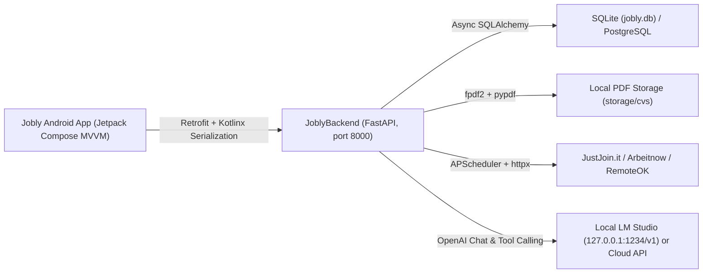

# Jobly

**Jobly** is a Kotlin + Jetpack Compose Android job-discovery and AI CV tailoring application backed by **JoblyBackend** (FastAPI + async SQLAlchemy). It pairs live external job scraping (JustJoin.it) and hybrid ML/heuristic job matching with real server-side PDF resume parsing, editing, and automatic location detection.

---

## Documentation Index

- **[Architecture Guide](docs/ARCHITECTURE.md)** — Android MVVM navigation, hybrid recommendation scoring, search engine pipeline, PDF generation/thumbnailing, AI tool calling, and database schema.
- **[API Reference](docs/API_REFERENCE.md)** — Complete specification of all 25 backend REST endpoints (`/offers`, `/user`, `/assistant`, `/notifications`, `/health`).
- **[Testing Guide](docs/TESTING.md)** — How to run and extend the black-box unit, HTTP E2E, and instrumented Android UI test suites (93 tests total).
- **[Backend README](../JoblyBackend/README.md)** — Backend environment setup, JustJoin.it scheduler, daily digest scheduler, and LLM endpoint configuration.

---

## Key Features

- **Personalized Home Feed (`HomeScreen`):**
  - **Next to you:** Geo-distance ranked job carousel (`HOME_OFFERS_LIMIT = 5`), automatically updated when your location changes via Settings or CV upload/edit.
  - **Best for you:** Multi-signal hybrid recommendations (`HOME_OFFERS_LIMIT = 5`) combining skill overlap, alias expansion, corpus TF-IDF / dense embeddings, seniority, geography, and application novelty.
  - **Your CVs:** Horizontal carousel displaying live page-1 thumbnails rendered on-device via Android `PdfRenderer` and cached in `CvThumbnailCache`.
- **Dedicated Search Engine (`SearchScreen`):**
  - Opened from the Home search bar or Sidebar **Search jobs** menu item.
  - Debounced live full-text search (`250 ms`) with typo tolerance, Polish diacritic folding (`krakow` -> `Kraków`, `Warsaw` <-> `Warszawa`), and tech aliases (`k8s`, `ts`, `py`, `postgres`).
  - Facet filters (**Remote / Hybrid / Office**, **Junior / Mid / Senior / Manager**, **B2B / UoP**, **Min Salary**) and 5 sort modes (**Relevance**, **Best match**, **Highest salary**, **Nearest**, **Newest**).
  - Preserves your query and filters when opening an offer detail card and pressing Back.
- **Formatted Job Offer Details (`OfferDetailScreen`):**
  - Displays match score, match reasons, skill chips, structured Markdown **About this role** formatting (`formatOfferDescriptionMarkdown` + `MarkdownText`), and **Apply on website** (records the application and launches `externalUrl`).
- **AI Career Assistant (`AssistantScreen`):**
  - Markdown-formatted replies powered by an OpenAI-compatible LLM proxy (`/assistant/chat`) with live tool calling (`update_cv` and `search_job_offers`).
  - `+` CV selection menu lets you switch the active CV (`✓` indicator), create a clean empty CV (`new-cv.pdf` containing only your contact header), or upload a PDF CV (`.pdf`, max 5 MB, max 10 pages, max 10 CVs).
  - Tapping a generated/edited CV card previews all pages in-app via `PdfPreviewDialog` with native share/open-external support via `FileProvider`.
- **Automatic CV Localization:**
  - Uploading or editing a CV PDF (via API or AI Assistant) automatically extracts city and coordinates from the CV text (`extract_location_from_cv_text`) to sync user location and **Next to you** rankings; if no recognized city is present, existing location settings are preserved.
- **Onboarding, Profile, Settings, Help & Daily Digest Notifications:**
  - First-time 3-step `OnboardingScreen` for profile info, city preferences, and initial CV setup.
  - Expandable inline **My applications** and **My CVs** sections on `ProfileScreen`.
  - Dedicated `SettingsScreen` (work radius, currency, city, job alerts, daily digest toggle + manual trigger) and `HelpFeedbackScreen` (`POST /user/feedback`).
  - Periodic 24-hour best-match daily digest pushed from the server and displayed on Android via `JoblyNotificationHelper`.
  - Locked to portrait orientation (`android:screenOrientation="portrait"`) in `AndroidManifest.xml`.

---

## System Architecture



---

## Tech Stack

| Layer | Technology |
|---|---|
| Android UI | Kotlin `2.2.10`, Jetpack Compose BOM `2024.09.00`, Material 3 |
| Android Platform | `minSdk = 35`, `targetSdk = 36`, `compileSdk = 36`, `PdfRenderer`, `FileProvider` |
| Networking | Retrofit `2.11.0`, OkHttp `4.12.0`, Kotlinx Serialization `1.7.3` |
| Async & Lifecycle | Kotlin Coroutines `1.9.0`, Lifecycle ViewModel & Compose `2.8.3` |
| Backend Framework | FastAPI `>= 0.115.0`, Pydantic Settings, SQLAlchemy `>= 2.0.36` (`aiosqlite`) |
| PDF & Scheduling | `pypdf >= 5.0.0`, `fpdf2 >= 2.8.1`, `APScheduler >= 3.10.4` |
| Testing | Pytest + `httpx.ASGITransport`, JUnit 4 + `kotlinx-coroutines-test`, Compose UI Test + `AndroidJUnit4` |

---

## Quick Start

### 1. Start JoblyBackend (and optional Local LLM)

```powershell
cd JoblyBackend
python -m venv .venv
.\.venv\Scripts\pip.exe install -r requirements.txt
Copy-Item .env.example .env
.\.venv\Scripts\uvicorn.exe app.main:app --host 0.0.0.0 --port 8000 --reload
```

- For AI chat & CV editing, run **LM Studio** (or another OpenAI-compatible server) on `http://127.0.0.1:1234/v1`, or configure `LLM_BASE_URL` and `LLM_API_KEY` in `JoblyBackend/.env`.
- Swagger UI is available at `http://localhost:8000/docs`.

### 2. Build & Run Jobly on Emulator or Device

`NetworkConfig.kt` automatically selects:
- **Android Emulator:** `http://10.0.2.2:8000`
- **Physical Device:** `http://127.0.0.1:8000` (pair with `adb reverse tcp:8000 tcp:8000`)

```powershell
cd Jobly
.\gradlew.bat assembleDebug
adb install -r app\build\outputs\apk\debug\app-debug.apk
adb shell am start -n com.example.jobly/.MainActivity
```

---

## Project Structure

```text
app/src/main/java/com/example/jobly/
├── data/
│   ├── remote/
│   │   ├── NetworkConfig.kt            # Emulator/device base URL detection & OkHttp/Retrofit builders
│   │   ├── api/                        # OffersApi, AssistantApi, NotificationsApi, UserApi
│   │   └── dto/                        # Kotlinx Serialization request/response DTOs & domain mappers
│   └── repository/                     # Remote & Mock repositories + seed data
├── di/
│   └── AppContainer.kt                 # Manual DI container & ViewModelProvider.Factory
├── model/
│   └── JoblyModels.kt                  # Core domain models (JobOffer, CvItem, UserSettings, etc.)
└── ui/
    ├── JoblyApp.kt                     # Root navigation state, drawer, dialogs, top/bottom bars
    ├── assistant/                      # AssistantScreen, AssistantViewModel (+ CV picker & Markdown)
    ├── common/                         # CvThumbnailCache, PdfPreviewDialog, MarkdownText, shared cards
    ├── help/                           # HelpFeedbackScreen
    ├── home/                           # HomeScreen, HomeViewModel (Next to you, Best for you, Your CVs)
    ├── notifications/                  # NotificationsScreen, NotificationsViewModel, NotificationHelper
    ├── offer/                          # OfferDetailScreen & formatOfferDescriptionMarkdown
    ├── onboarding/                     # 3-step first-run OnboardingScreen
    ├── profile/                        # ProfileScreen, ProfileViewModel (expandable apps & CVs)
    ├── search/                         # SearchScreen, SearchViewModel
    ├── settings/                       # SettingsScreen (city, radius, currency, daily digest controls)
    └── theme/                          # Color tokens & Material 3 theme
```

---

## Testing Quick Reference

```powershell
# Backend unit + HTTP E2E tests (64 tests)
cd JoblyBackend
.\.venv\Scripts\pytest.exe -v

# Android JVM unit tests (23 tests)
cd Jobly
.\gradlew.bat testDebugUnitTest

# Android instrumented Compose UI & live E2E tests (6 tests, requires emulator + backend running)
.\gradlew.bat connectedDebugAndroidTest
```

See [docs/TESTING.md](docs/TESTING.md) for a detailed breakdown of all suites.
