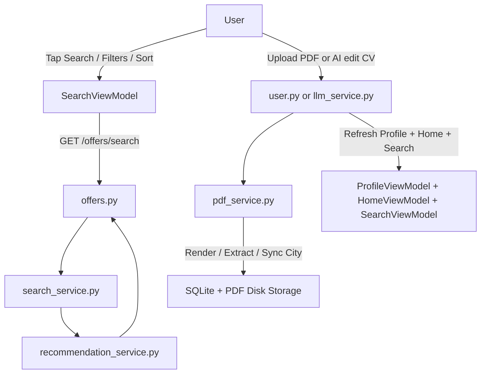
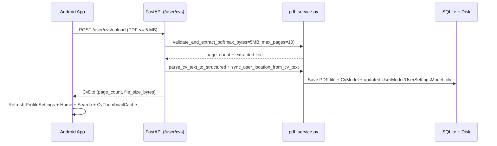

# Jobly Architecture Guide

This document describes the end-to-end architecture across the **Jobly** Android client and **JoblyBackend** server.

---

## 1. High-Level Request & Data Flow

---

## 2. Android MVVM & Navigation (`Jobly`)

### Dependency Injection (`di/AppContainer.kt`)
`DefaultAppContainer` constructs two shared `OkHttpClient` instances (30 s read timeout for standard APIs; 120 s read timeout for `/assistant/` LLM calls), creates four separate Retrofit services (`OffersApi`, `AssistantApi`, `NotificationsApi`, `UserApi`), binds them into `Remote*Repository` implementations, and exposes a single `ViewModelProvider.Factory` creating:
- `HomeViewModel`
- `AssistantViewModel`
- `NotificationsViewModel`
- `ProfileViewModel`
- `SearchViewModel`

### Navigation & Overlay Hierarchy (`ui/JoblyApp.kt`)
`JoblyApp` manages persistent onboarding via `SharedPreferences("jobly_prefs", "onboarding_completed")` and renders screens in strict precedence so overlay back navigation preserves underlying state:

1. **`showOnboarding == true`** -> renders `OnboardingScreen` (3-step wizard: Identity & Contact, Job Location & Preferences, CV Upload/Creation).
2. **`selectedOffer != null`** -> renders full-screen `OfferDetailScreen`. Because this check sits **above** `SecondaryScreen`, opening a job offer from `SearchScreen` and pressing Back returns cleanly to `SearchScreen` with the query, active filters, scroll position, and results intact.
3. **`secondaryScreen != null`** -> renders one of:
   - `SecondaryScreen.SEARCH` -> `SearchScreen`
   - `SecondaryScreen.SETTINGS` -> `SettingsScreen`
   - `SecondaryScreen.HELP_FEEDBACK` -> `HelpFeedbackScreen`
4. **Main Shell (`ModalNavigationDrawer` + `Scaffold`)** -> top bar (`JoblyTopBar`), bottom bar (`JoblyBottomBar`, auto-hidden when the software keyboard is open), and active `JoblyTab` (`HOME`, `ASSISTANT`, `NOTIFICATIONS`, `PROFILE`).

---

## 3. Search Engine (`JoblyBackend/app/services/search_service.py`)

`GET /offers/search` delegates to `search_service.search_offers(...)`, combining strict facet filtering, relevance-ranked full-text matching, and personalized scoring:

1. **Normalization & Linguistic Tolerance:**
   - **Polish diacritic folding (`_fold_diacritics`):** Replaces `ł -> l` / `Ł -> L`, applies Unicode `NFKD` combining-mark removal, and lowercases all text so `krakow`, `wroclaw`, and `lodz` match `Kraków`, `Wrocław`, and `Łódź`.
   - **City equivalence:** Normalizes `warsaw` -> `warszawa` on both queries and offer fields.
   - **Tech alias canonicalization:** Reuses `_PHRASE_ALIASES` and `_TOKEN_ALIASES` from `recommendation_service.py` (`k8s -> kubernetes`, `ts -> typescript`, `py -> python`, `postgres -> postgresql`, `qa -> testing`, etc.).
   - **Typo tolerance:** Uses `difflib.SequenceMatcher` with threshold `>= 0.80` for query tokens of length `>= 4` against offer title, skill, and company tokens (e.g., `pyhton -> python`, `kubernets -> kubernetes`).
2. **Query Scoring (`_score_query_match`):**
   - Multi-word queries use strict **AND** semantics (every query term must hit at least one field).
   - Field weights prioritize exact/alias token hits in Title (`+20`), Skills (`+18`), Company (`+14`), Description/Meta (`+6`), substring/prefix matches (`+12/+10/+8/+4`), fuzzy matches (`+9`), and full-phrase bonuses (`+40` Title, `+25` Skills, `+20` Company, `+10` Description).
3. **Structured Facets (`_matches_facets`):**
   - Filters on `level`, `contract_type`, `work_mode` (`remote`, `hybrid`, `office`), `city`, and `min_salary` (`parse_salary_bounds` parses space-delimited ranges like `"19 500 - 29 500"`, excludes `"Undisclosed"` when `min_salary > 0`, and normalizes genuine hourly rates `< 1000` by `160x`).
4. **Sorting & Pagination:**
   - Sorts by `relevance` (text score, then match score, then recency), `best_match`, `salary_desc`, `nearest` (prepends distance reason `"X km away"` when coordinates exist), or `newest`, returning `(total, paginated_offers)`.

---

## 4. Hybrid Recommendation Engine (`recommendation_service.py`)

- **Next to you (`score_around_you`):** Ranks offers by Haversine distance from `(user_lat, user_lon)`, guarding safely against offers with `None` coordinates (sorted last via `math.inf` unless excluded by `radius_km`), and tags remote-friendly listings.
- **Best for you (`score_best_for_you`):** Computes a weighted `[0, 100]` compatibility score per offer:
  - `0.38` **Skill overlap:** Token + canonical alias + phrase matching against the user's active CV skills and full text (falls back to semantic similarity when an offer lists no explicit skills).
  - `0.24` **Semantic similarity:** Corpus TF-IDF cosine similarity blended `50/50` with dense embedding cosine similarity when embeddings are available from the LLM endpoint.
  - `0.14` **Title & role alignment:** Overlap between offer title tokens and CV headline/summary tokens.
  - `0.10` **Seniority alignment:** Compares inferred CV seniority ordinal (`0..4`) with offer level.
  - `0.09` **Geo / remote compatibility:** `1.0` if remote or `<= 25 km`, exponential decay `exp(-dist_km / 180)` otherwise, `0.5` if coordinates are absent.
  - `0.05` **Application history affinity:** Jaccard similarity with previously applied offers.
  - `-0.08` **Novelty penalty:** Mildly deprioritizes already-applied offers so fresh recommendations surface first.

---

## 5. PDF CV Pipeline & Location Extraction

- **Limits & Sanitization:** Upload streaming enforces `5 MB` (`413` on overflow), `%PDF-` magic header, non-encrypted readable pages, max `10` pages (`400`), max `10` CVs per user (`400`), and path-traversal/length-safe filenames via `sanitize_filename(..., max_length=100)` defaulting to `new-cv.pdf`.
- **Empty CV Creation (`POST /user/cvs`):** Explicitly clears template fields (`headline=""`, `summary=""`, `skills=[]`, `experience=[]`, `education=""`, `languages=[]`, `certifications=[]`, `extra_sections={}`) so blank CVs contain only your name and contact header.
- **Unicode PDF Generation:** `render_cv_pdf` renders structured CVs via `fpdf2` (with TTF Unicode font support when available and Latin-1 fallback replacements) so Polish characters are preserved.
- **City Localization (`extract_location_from_cv_text` / `sync_user_location_from_cv_text`):** Scans for known Polish and European cities (including diacritic and locative Polish forms such as `Krakowie`, `Wrocławiu`, `Gdańsku`, `Warszawie`), prioritizing newly edited text, explicit location/address labels, and the top 6 header lines before scanning body text. Skips updates cleanly if no city is detected.
- **Android Rendering (`CvThumbnailCache.kt` & `PdfPreviewDialog.kt`):** Downloads raw PDF bytes and uses Android's `PdfRenderer` to render page-1 PNG thumbnails cached in memory (`LruCache`) and `cacheDir/cv_thumbs` keyed by CV ID and metadata revision hash.

---

## 6. AI Assistant & Tool Calling (`llm_service.py`)

`OpenAiCompatibleClient` communicates with any OpenAI-compatible `/v1/chat/completions` endpoint (defaulting to LM Studio at `http://127.0.0.1:1234/v1`) and runs up to multi-turn tool execution loops with two registered tools:

| Tool | Behavior |
|---|---|
| `update_cv` | Updates structured CV sections (preserving unmodified fields & extra sections), regenerates the `.pdf` on disk, re-computes embeddings, syncs user location if city info changed, and returns `updated_cv` to the app. |
| `search_job_offers` | Runs recommendation ranking / keyword filtering over the database and attaches up to top matching offers directly into `suggested_offers` in `AssistantChatResponseDto`. |

---

## 7. Database Schema (`app/models.py`) & Schedulers (`app/main.py`)

| Table | Purpose |
|---|---|
| `users` | Default user profile (`id`, `name`, `phone`, `email`, `latitude`, `longitude`) |
| `job_offers` | Scraped & seeded offers (`title`, `salary_range`, `salary_unit`, `skills_json`, `company_name`, `level`, `contract_type`, `work_schedule`, `description`, `source`, `external_url`, coords, `embedding_json`) |
| `cvs` | User CV records pointing to `.pdf` files on disk (`raw_text`, `structured_json`, `embedding_json`) |
| `applications` | Applied job records with `UniqueConstraint("user_id", "offer_id")` |
| `notifications` | Job alert & daily digest notifications (`heading`, `offer_id`, `is_read`) |
| `user_settings` | Persistent alerts, daily digest flag, radius, currency, city, and `onboarding_completed` flag |
| `feedback_messages` | Submitted user feedback (`category`, `message`, `contact_email`) |

When `ENABLE_SCHEDULER=true`, `APScheduler` registers two interval jobs:
1. **`scrape_job_offers`** (default every `60` minutes): Fetches offers from `JustJoinItScraper`, `ArbeitnowScraper`, and `RemoteOkScraper`, deduplicating via `external_url` and inserting high-match notifications for qualifying new offers.
2. **`daily_best_offer_notification`** (default every `24` hours, when `ENABLE_DAILY_NOTIFICATION=true` and `user_settings.daily_digest_enabled=true`): Selects the top matched unread/non-applied offer and creates a daily digest notification.
