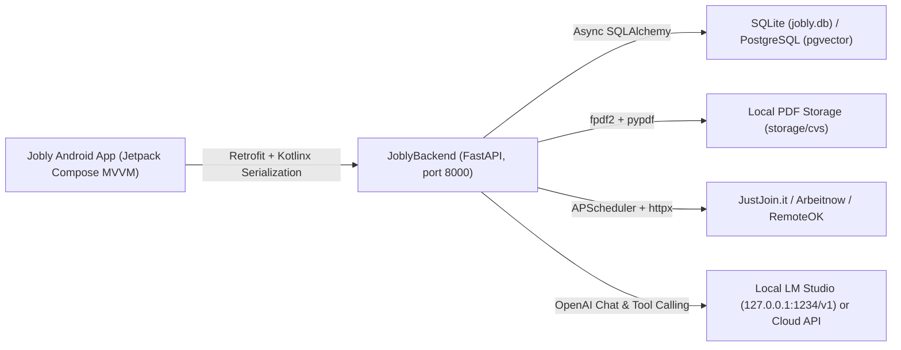

# Jobly

**Jobly** is a full-stack job-discovery and AI CV-tailoring platform structured as a monorepo containing the **Android mobile client** (`Jobly`) and the **FastAPI backend** (`JoblyBackend`).

It combines live job scraping (JustJoin.it, Arbeitnow, RemoteOK), hybrid ML/heuristic job matching, full-text faceted search, and an AI Career Assistant capable of searching offers and editing PDF CVs in place.

---

## Repository Structure

```text
jobly-app/
├── Jobly/                 # Kotlin + Jetpack Compose Android app (MVVM)
│   ├── app/               # Android application source & tests
│   ├── docs/              # Architecture, API reference, and testing guides
│   └── README.md          # Android app overview & structure
└── JoblyBackend/          # FastAPI + Async SQLAlchemy backend
    ├── app/               # REST API, recommendation/search services, scrapers, PDF & LLM logic
    ├── tests/             # Pytest unit & HTTP E2E test suite
    ├── docker-compose.yml # PostgreSQL (pgvector) + API container setup
    └── README.md          # Backend setup, env vars, and module details
```

---

## System Architecture



---

## Key Features

- **Personalized Home Feed:** Geo-distance ranked **Next to you** carousel, hybrid ML/heuristic **Best for you** recommendations, and a **Your CVs** carousel with on-device `PdfRenderer` thumbnails.
- **Full-Text & Faceted Search:** Debounced live search with typo tolerance, Polish diacritic folding (`krakow` ↔ `Kraków`, `Warsaw` ↔ `Warszawa`), tech alias expansion (`k8s`, `ts`, `py`, `postgres`), multi-facet filters, and 5 sort modes.
- **AI Career Assistant & PDF CV Management:** OpenAI-compatible chat with live tool calling (`update_cv`, `search_job_offers`), blank CV creation, PDF upload/parsing/editing, in-app multi-page PDF preview, and native sharing.
- **Automatic CV Localization:** Uploading or editing a CV automatically extracts city/coordinates from CV text to keep **Next to you** rankings and location settings in sync.
- **Automated Scraping & Daily Digest:** Scheduled job ingestion via `APScheduler` and periodic 24-hour best-match digest notifications pushed to the Android client.
- **Onboarding, Profile & Settings:** 3-step first-run onboarding, application history tracking, work radius/currency/city preferences, and in-app feedback submission.

---

## Tech Stack

| Layer | Technologies |
|---|---|
| **Android App** | Kotlin `2.2.10`, Jetpack Compose BOM `2024.09.00`, Material 3, `minSdk 35` / `targetSdk 36` |
| **Android Networking & Async** | Retrofit `2.11.0`, OkHttp `4.12.0`, Kotlinx Serialization `1.7.3`, Coroutines `1.9.0` |
| **Backend API** | Python `3.12`, FastAPI `>= 0.115.0`, Pydantic Settings, Async SQLAlchemy `>= 2.0.36` |
| **Database** | SQLite (`aiosqlite`) for local dev, PostgreSQL + `pgvector` via Docker Compose |
| **PDF & Scheduling** | `pypdf >= 5.0.0`, `fpdf2 >= 2.8.1`, `APScheduler >= 3.10.4` |
| **AI / LLM** | OpenAI-compatible API (local LM Studio on `127.0.0.1:1234/v1` or any cloud provider) |
| **Testing** | Pytest + `httpx.ASGITransport`, JUnit 4 + `kotlinx-coroutines-test`, Compose UI Test |

---

## Prerequisites

- **Python 3.12+** (or **Docker & Docker Compose** for the containerized PostgreSQL + API stack)
- **Android Studio** with Android SDK `36` (and an emulator or physical device running API `35+`)
- **Optional (for AI Assistant):** [LM Studio](https://lmstudio.ai/) running locally on `http://127.0.0.1:1234/v1`, or an OpenAI-compatible cloud endpoint configured in `JoblyBackend/.env`

---

## Quick Start

### 1. Run the Backend (`JoblyBackend`)

#### Option A: Local Python (SQLite)

```powershell
cd JoblyBackend
python -m venv .venv
.\.venv\Scripts\pip.exe install -r requirements.txt
Copy-Item .env.example .env
.\.venv\Scripts\uvicorn.exe app.main:app --host 0.0.0.0 --port 8000 --reload
```

#### Option B: Docker Compose (PostgreSQL + `pgvector`)

```bash
cd JoblyBackend
docker compose up --build
```

Once running, the interactive OpenAPI / Swagger UI is available at `http://localhost:8000/docs`.

### 2. Build & Run the Android App (`Jobly`)

`NetworkConfig.kt` automatically routes API traffic depending on the target:
- **Android Emulator:** `http://10.0.2.2:8000`
- **Physical Device:** `http://127.0.0.1:8000` (run `adb reverse tcp:8000 tcp:8000` over USB)

Open the `Jobly/` folder in Android Studio, or build and install from the command line:

```powershell
cd Jobly
.\gradlew.bat assembleDebug
adb install -r app\build\outputs\apk\debug\app-debug.apk
adb shell am start -n com.example.jobly/.MainActivity
```

---

## Running Tests

The repository includes **93 tests** across three suites:

```powershell
# 1. Backend unit & HTTP E2E tests (64 tests)
cd JoblyBackend
.\.venv\Scripts\pytest.exe -v

# 2. Android JVM unit tests (23 tests)
cd ..\Jobly
.\gradlew.bat testDebugUnitTest

# 3. Android instrumented Compose UI & live E2E tests (6 tests — requires emulator + running backend)
.\gradlew.bat connectedDebugAndroidTest
```

---

## Documentation

- **[Android App README](Jobly/README.md)** — Features, mobile module breakdown, and build instructions.
- **[Backend README](JoblyBackend/README.md)** — Core services, environment variables, database tables, and Docker setup.
- **[Architecture Guide](Jobly/docs/ARCHITECTURE.md)** — End-to-end MVVM architecture, recommendation scoring, search pipeline, PDF handling, and AI tool calling.
- **[API Reference](Jobly/docs/API_REFERENCE.md)** — Full specification for all 25 backend REST endpoints.
- **[Testing Guide](Jobly/docs/TESTING.md)** — Detailed breakdown of backend, JVM, and instrumented Android test suites.
